# Student Profile and Skill Development Management System

A **Spring Boot** application that maintains student personal information, academic scores and technical skills in a **MySQL** database. It applies business rules, uses Java collections and streams for data manipulation, and can be used in three ways:

- a **menu-driven console program** (runs in the Eclipse console),
- a **REST API** (tested with Postman),
- the **MySQL database** itself (checked in phpMyAdmin with plain SQL).

Built for the OOPJ (CS336B) MSE-2 case study. It covers **Q1(a)** (Student class), **Q2(a)** (MySQL database and requirements) and **Q3(a)** (Spring Boot REST APIs).

---

## Table of contents

1. [Features](#features)
2. [Tech stack and dependencies](#tech-stack-and-dependencies)
3. [Project structure](#project-structure)
4. [Architecture and how it runs](#architecture-and-how-it-runs)
5. [Prerequisites](#prerequisites)
6. [Setup and run (Eclipse + XAMPP)](#setup-and-run-eclipse--xampp)
7. [Console menu](#console-menu)
8. [REST API (Postman)](#rest-api-postman)
9. [Database design and SQL](#database-design-and-sql)
10. [Business rules](#business-rules)
11. [Sample data](#sample-data)
12. [How the question maps to the code](#how-the-question-maps-to-the-code)
13. [Screenshots](#screenshots)
14. [Troubleshooting](#troubleshooting)

---

## Features

- **Student model** with encapsulation, constructors, getters/setters and object methods (`toString`, `equals`, `hashCode`).
- **Average score**, **performance category** and **stronger subject** for every student.
- **Search** by student ID, email or course.
- **Merit list** sorted by average score (descending) with rank; equal averages share a rank.
- **Students with identical technical skill sets** (grouped).
- **Students weak in programming but strong in mathematics** (default: programming below 50, mathematics at least 75; thresholds can be changed).
- **Validation**: duplicate student IDs and duplicate emails are rejected, scores must be between 0 and 100.
- Full **CRUD** through REST endpoints, with proper HTTP status codes (201, 400, 404, 409).
- **10 sample students** are inserted automatically on first run.

## Tech stack and dependencies

| Technology | Version | Purpose |
|---|---|---|
| Java | 17+ | Language |
| Spring Boot | 3.3.5 | Application framework (`spring-boot-starter-parent`) |
| `spring-boot-starter-web` | managed | REST controllers, embedded Tomcat, JSON (Jackson) |
| `spring-boot-starter-data-jpa` | managed | Spring Data JPA, Hibernate, HikariCP connection pool |
| `mysql-connector-j` | managed | JDBC driver for MySQL |
| `spring-boot-starter-test` | managed | Testing support (default, test scope) |
| MySQL / MariaDB (XAMPP) | any recent | Database |
| Maven | via Eclipse | Build and dependency management |
| Eclipse IDE for Enterprise Java | any recent | Development |
| Postman | any | API testing |

> The data layer uses Spring Data JPA (Hibernate), which runs on top of JDBC and the MySQL connector.

## Project structure

```
JAVA_MSE-2
├── pom.xml                                     Maven dependencies
├── README.md
├── database/
│   ├── database.sql                            Database, tables, 10 students, view
│   └── queries.sql                             One SQL query per Q2 requirement
├── postman/
│   └── Student_Profile_System.postman_collection.json
├── docs/screenshots/                           Output screenshots used in this README
└── src/main
    ├── resources/application.properties        DB connection and settings
    └── java/com/example/studentprofile
        ├── StudentProfileApplication.java      Entry point + inserts 10 sample students
        ├── StudentMenu.java                    Menu-driven console program
        ├── model/Student.java                  Q1: Student class (also the DB entity)
        ├── dto/
        │   ├── MeritEntry.java                 One row of the merit list
        │   ├── PerformanceEntry.java           Average, category, stronger subject
        │   └── SameSkillGroup.java             Group of students with same skills
        ├── repository/StudentRepository.java   Database access (Spring Data JPA)
        ├── service/StudentService.java         Business logic, validation, collections/streams
        └── controller/StudentController.java   REST endpoints
```

## Architecture and how it runs

```
Postman / Browser                    Eclipse Console (keyboard)
       │  HTTP + JSON                       │
       ▼                                    ▼
StudentController (REST API)         StudentMenu (console menu)
       └─────────────────┬──────────────────┘
                         ▼
                 StudentService          business rules, validation, streams
                         ▼
               StudentRepository         Spring Data JPA
                         ▼
               Hibernate + MySQL driver
                         ▼
             MySQL (XAMPP) → student_skill_db
```

What happens when the application starts:

1. `StudentProfileApplication.main()` starts Spring Boot, which scans the package and creates all components.
2. Spring reads `application.properties` and connects to MySQL. The database `student_skill_db` is created automatically if it does not exist (`createDatabaseIfNotExist=true`).
3. Hibernate creates the `students` and `student_skills` tables if missing (`ddl-auto=update`).
4. The embedded Tomcat server starts and the REST API goes live.
5. Runner 1 (`@Order(1)`) inserts the 10 sample students if the table is empty.
6. Runner 2 (`@Order(2)`, `StudentMenu`) shows the console menu and waits for input. The REST API keeps working at the same time.

## Prerequisites

- JDK 17 or higher
- Eclipse IDE for Enterprise Java (Maven support included)
- XAMPP with **Apache** and **MySQL** running (default: user `root`, empty password, port 3306)
- Postman (optional, for the REST API)

## Setup and run (Eclipse + XAMPP)

1. **Clone the repository**
   ```bash
   git clone https://github.com/codeItAnuj/JAVA_MSE-2.git
   ```
2. **Start MySQL** in the XAMPP Control Panel.
3. **Import into Eclipse**: `File → Import → Maven → Existing Maven Projects`, select the cloned folder, tick `pom.xml`, click **Finish**. After Maven finishes downloading, right-click the project → `Maven → Update Project` (tick *Force Update*).
4. **Run**: right-click `StudentProfileApplication.java` → `Run As → Java Application`.
5. The console prints `10 sample students inserted` and `Started StudentProfileApplication`, then the menu appears. Click inside the **Console** tab, type a number and press Enter.
6. **Check the database**: open <http://localhost/phpmyadmin> and select `student_skill_db`.

Configuration lives in `src/main/resources/application.properties`:

| Property | Default | Meaning |
|---|---|---|
| `server.port` | `8080` | Port of the REST API (change if 8080 is busy) |
| `spring.datasource.url` | `jdbc:mysql://localhost:3306/student_skill_db?...` | MySQL database |
| `spring.datasource.username` / `password` | `root` / *(empty)* | XAMPP defaults |
| `spring.jpa.hibernate.ddl-auto` | `update` | Creates tables automatically |
| `app.menu.enabled` | `true` | Set to `false` to run only the REST API |

## Console menu

```
 1. Average score, performance category, stronger subject
 2. Search student by ID
 3. Search student by email
 4. Search students by course
 5. Merit list (average score, highest first)
 6. Students having the same technical skills
 7. Need improvement in programming but maths >= 75
 8. Add a new student (duplicate ID / score validation)
 0. Exit
```

## REST API (Postman)

Base URL: `http://localhost:8080/api/students` (use your own port if you changed `server.port`).
A ready-made Postman collection is in [`postman/`](postman/Student_Profile_System.postman_collection.json) (Postman → Import).

| Requirement | Method | URL |
|---|---|---|
| Add a student (Q3.1) | POST | `/api/students` |
| Retrieve all students (Q3.2) | GET | `/api/students` |
| Search by ID (Q3.3) | GET | `/api/students/{id}` |
| Update scores and skills (Q3.4) | PUT | `/api/students/{id}` |
| Delete a student (Q3.5) | DELETE | `/api/students/{id}` |
| Display the merit list (Q3.6) | GET | `/api/students/merit-list` |
| Average, category, stronger subject (Q2.1–2.3) | GET | `/api/students/performance` |
| Search by ID, email or course (Q2.4) | GET | `/api/students/search?id=101` · `?email=...` · `?course=BCA` |
| Same technical skills (Q2.6) | GET | `/api/students/same-skills` |
| Weak in programming, maths ≥ 75 (Q2.7) | GET | `/api/students/needs-programming-improvement` (optional `?programmingBelow=50&mathMin=75`) |
| Students having one skill (extra) | GET | `/api/students/skill/{skill}` |

**POST body** (Body → raw → JSON):

```json
{
  "studentId": 111,
  "studentName": "Test Student",
  "email": "test.student@example.com",
  "courseName": "BCA",
  "programmingScore": 72,
  "mathematicsScore": 80,
  "technicalSkills": ["Java", "SQL"]
}
```

**PUT body** (only the fields you send are changed):

```json
{
  "programmingScore": 95,
  "mathematicsScore": 90,
  "technicalSkills": ["Java", "Spring Boot", "MySQL"]
}
```

**Responses and validation**

| Situation | Status |
|---|---|
| Student created | `201 Created` |
| Success (GET / PUT / DELETE) | `200 OK` |
| Score below 0 or above 100, missing or invalid field | `400 Bad Request` |
| Student not found | `404 Not Found` |
| Duplicate student ID or email | `409 Conflict` |

Errors are returned as JSON, for example `{"error": "Student ID 101 already exists"}`.

## Database design and SQL

**`students`**: `student_id` (primary key, entered by the user), `student_name`, `email` (unique), `course_name`, `programming_score`, `mathematics_score`.

**`student_skills`**: `student_id` (foreign key to `students`) and `skill`, one row per skill. The list of technical skills is stored in its own table (`@ElementCollection`).

The primary key rejects duplicate IDs. In [`database/database.sql`](database/database.sql) `CHECK` constraints also reject scores outside 0–100, and the view `student_performance` calculates average, category and stronger subject in SQL.

**Using the SQL files in phpMyAdmin**

1. Open <http://localhost/phpmyadmin> → **SQL** tab.
2. Paste [`database/database.sql`](database/database.sql) → **Go** (safe to run more than once, and also after the application has created the tables).
3. Select `student_skill_db` → **SQL** tab → run the queries from [`database/queries.sql`](database/queries.sql) one at a time.

## Business rules

| Rule | Definition |
|---|---|
| Average score | (programming + mathematics) / 2 |
| Performance category | 85 or above: **Excellent** · 70–84.99: **Good** · 50–69.99: **Satisfactory** · below 50: **Needs Improvement** |
| Stronger subject | The subject with the higher score, or *Both Equal* |
| Merit list | Sorted by average, highest first; equal averages share the same rank |
| Same technical skills | Students grouped by their identical skill set (case-insensitive); only groups with 2 or more students are shown |
| Needs improvement in programming | Programming score below 50 and mathematics score at least 75 |
| Validation | Scores between 0 and 100, unique student ID, unique and valid email, name and course required |

## Sample data

| ID | Name | Course | Prog | Math | Average | Category | Stronger | Skills |
|---|---|---|---|---|---|---|---|---|
| 101 | Aarav Sharma | B.Tech CSE | 92 | 88 | 90.00 | Excellent | Programming | Java, Spring Boot, MySQL |
| 102 | Priya Singh | B.Tech CSE | 78 | 85 | 81.50 | Good | Mathematics | Python, SQL, Machine Learning |
| 103 | Rohan Verma | BCA | 45 | 82 | 63.50 | Satisfactory | Mathematics | HTML, CSS, JavaScript |
| 104 | Sneha Patel | B.Tech IT | 88 | 90 | 89.00 | Excellent | Mathematics | Java, Spring Boot, MySQL |
| 105 | Karan Mehta | BCA | 40 | 76 | 58.00 | Satisfactory | Mathematics | Python, SQL, Machine Learning |
| 106 | Ananya Gupta | MCA | 70 | 65 | 67.50 | Satisfactory | Programming | HTML, CSS, JavaScript |
| 107 | Vikram Rao | B.Tech CSE | 35 | 40 | 37.50 | Needs Improvement | Mathematics | C, Java |
| 108 | Neha Joshi | MCA | 95 | 91 | 93.00 | Excellent | Programming | Java, Python, Docker |
| 109 | Arjun Nair | B.Tech IT | 60 | 55 | 57.50 | Satisfactory | Programming | C++, DSA |
| 110 | Meera Iyer | BCA | 48 | 90 | 69.00 | Satisfactory | Mathematics | Excel, Power BI |

The sample data contains pairs of students with identical skills (101 and 104, 102 and 105, 103 and 106) and students who need programming improvement with mathematics of at least 75 (103, 105, 110).

## How the question maps to the code

| Question | Where |
|---|---|
| **Q1(a)** Student class (ID, name, email, course, programming score, mathematics score, list of skills; encapsulation, constructors, getters/setters, object methods) | [`model/Student.java`](src/main/java/com/example/studentprofile/model/Student.java) |
| **Q2(a)** MySQL database with tables | [`database/database.sql`](database/database.sql) and the entity mapping in `Student.java` |
| Q2.1 Average score | `Student.getAverageScore()`, view `student_performance` |
| Q2.2 Performance category | `Student.getPerformanceCategory()` |
| Q2.3 Stronger subject | `Student.getStrongerSubject()` |
| Q2.4 Search by ID, email or course | `StudentService.search()`, menu options 2–4 |
| Q2.5 Merit list | `StudentService.getMeritList()`, menu option 5 |
| Q2.6 Same technical skills | `StudentService.getSameSkillGroups()`, menu option 6 |
| Q2.7 Weak in programming, maths ≥ 75 | `StudentService.getNeedingProgrammingImprovement()`, menu option 7 |
| Q2.8 No duplicate IDs, scores 0–100 | Primary key + `CHECK` constraints, `StudentService.addStudent()`, menu option 8 |
| **Q3(a)** REST APIs (add, retrieve all, search by ID, update scores and skills, delete, merit list) | [`controller/StudentController.java`](src/main/java/com/example/studentprofile/controller/StudentController.java) |

## Screenshots

### Q1: Student model class

| | |
|---|---|
| 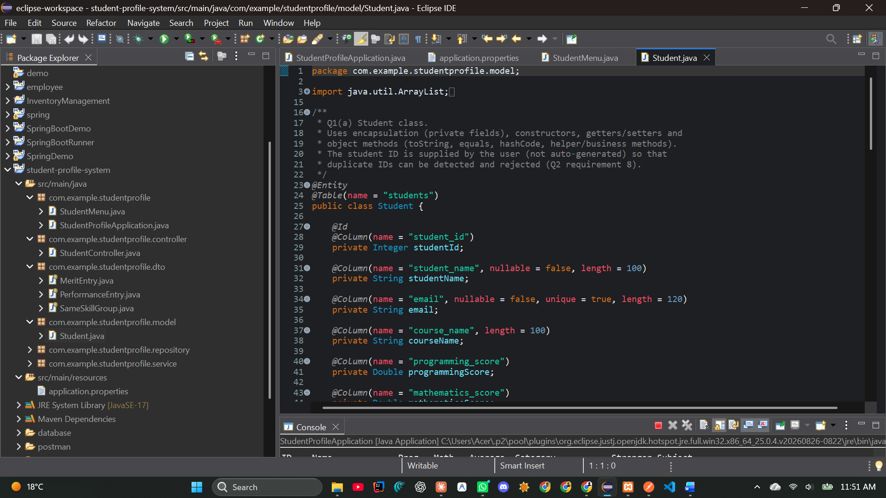 | 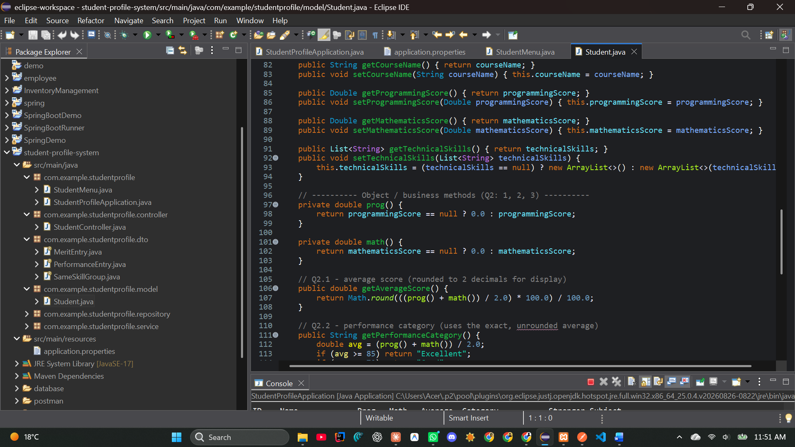 |
| Class header and private fields | Getters, setters and average score |
| 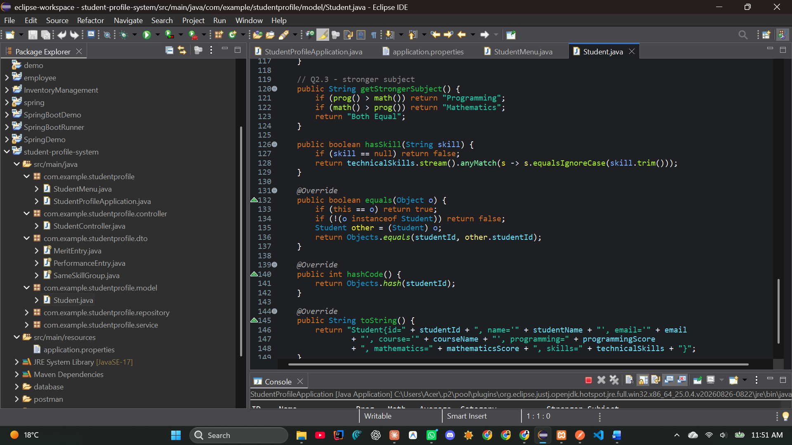 | 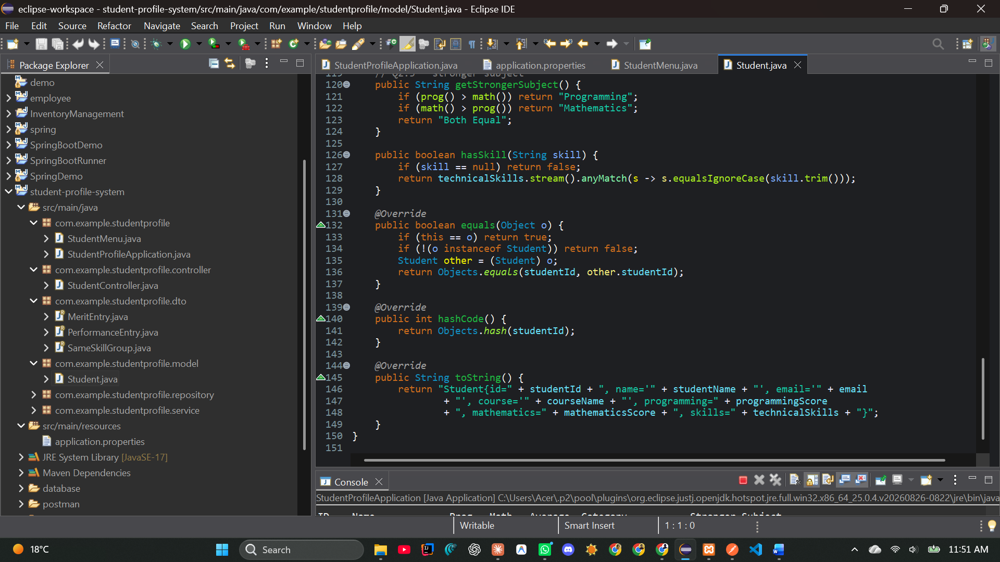 |
| `getStrongerSubject`, `hasSkill`, `equals`, `hashCode`, `toString` | End of the class |

### Q2: Menu-driven console program (data read from MySQL)

**Option 1: average, category, stronger subject**
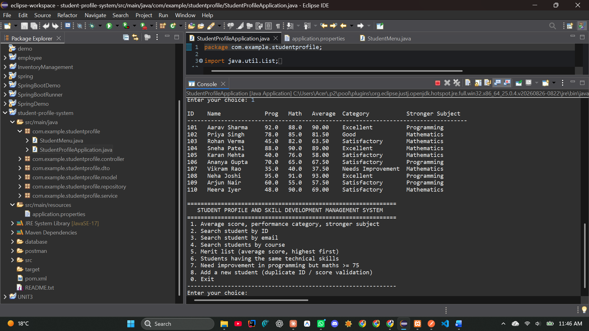

**Option 2: search by ID**
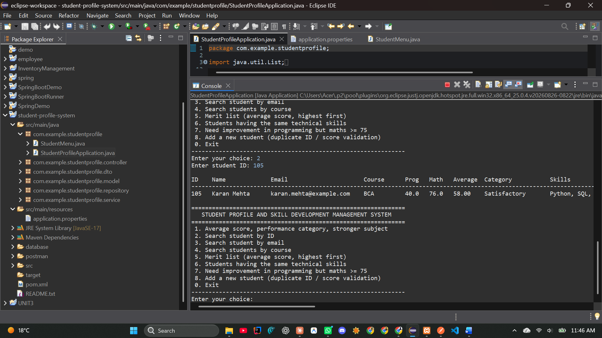

**Option 3: search by email**
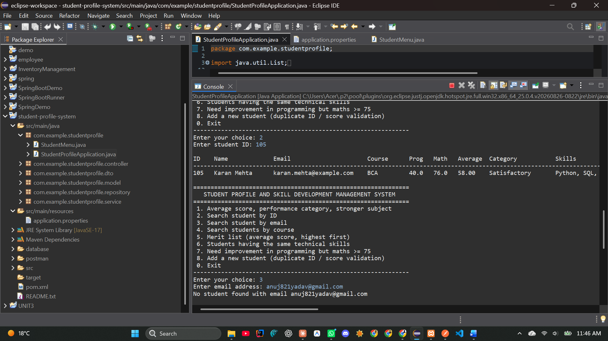

**Option 4: search by course**
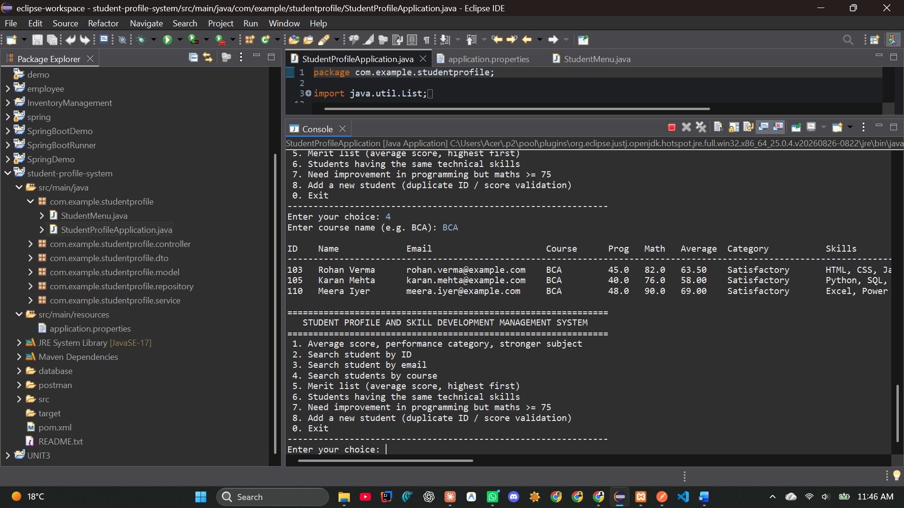

**Option 5: merit list**
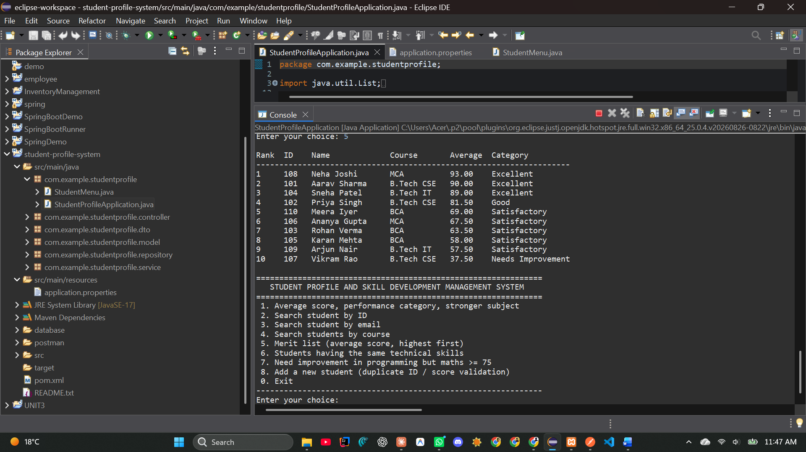

**Option 6: students with the same technical skills**
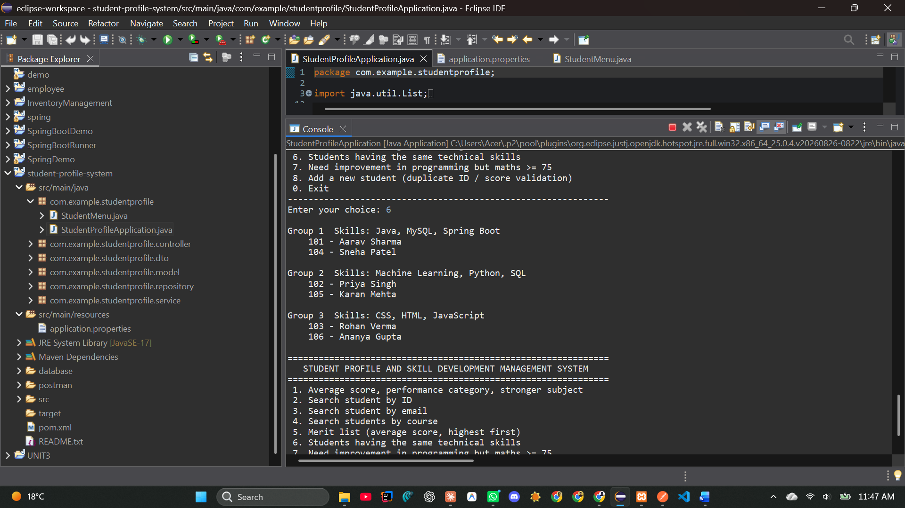

**Option 7: weak in programming, maths at least 75** (custom thresholds 60 and 78 entered)
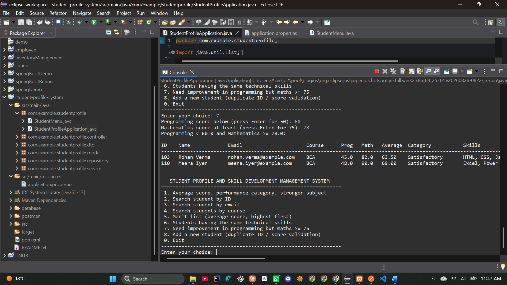

**Option 8: add a new student**
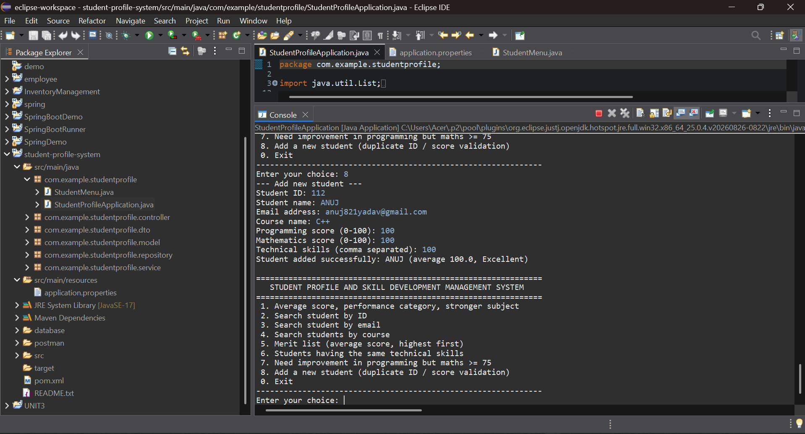

### MySQL in phpMyAdmin (`student_skill_db`)

**`students` table**
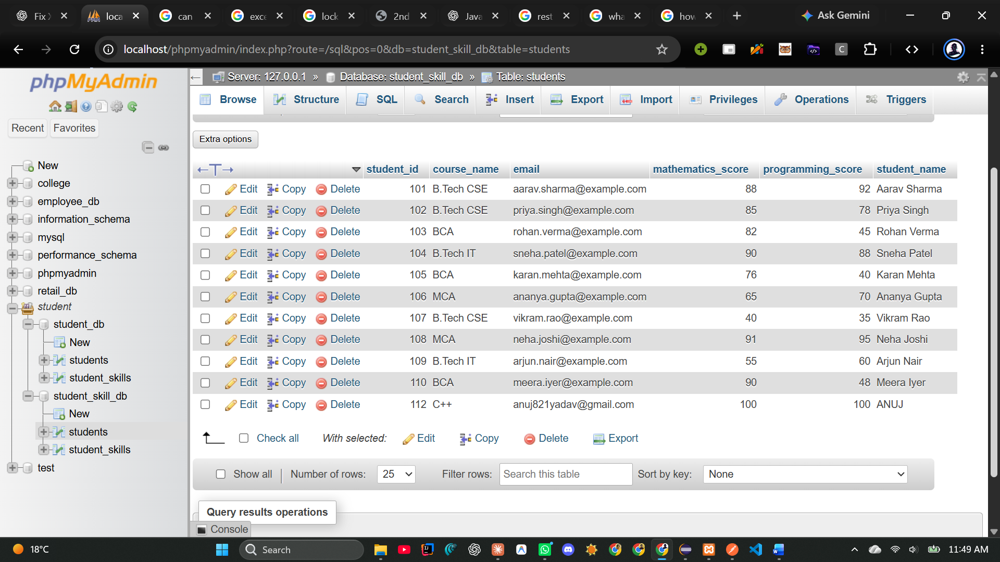

**`student_skills` table**
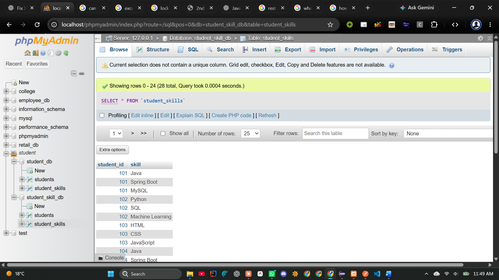
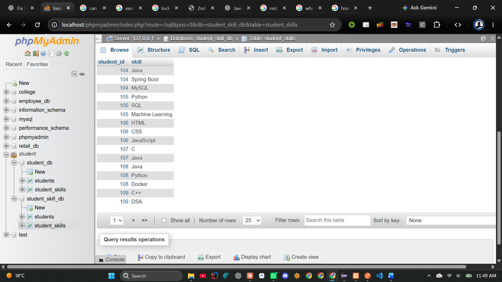

### Q3: REST API in Postman (merit list)

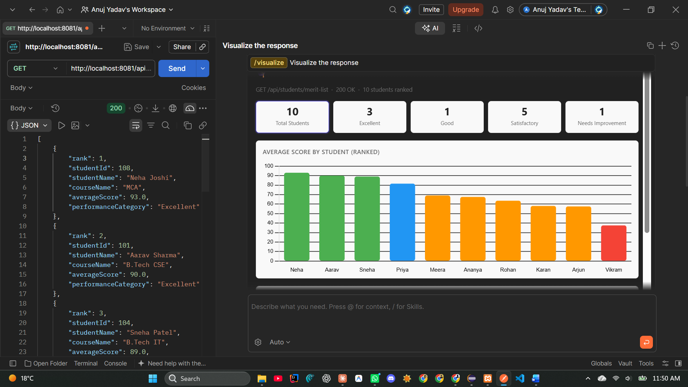
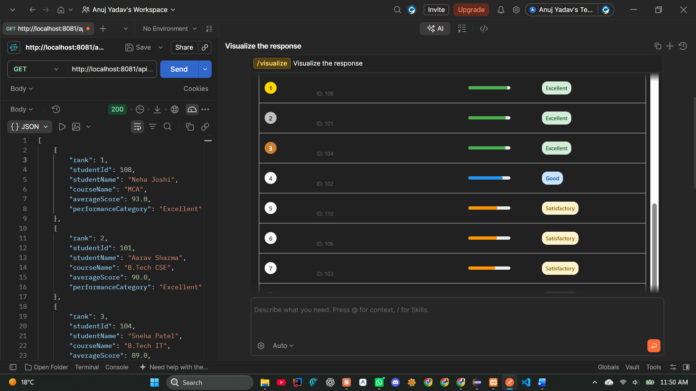

> The Postman screenshots were taken with `server.port=8081`. The default in this repository is `8080`.

## Troubleshooting

| Problem | Fix |
|---|---|
| `Communications link failure` | MySQL is not running in XAMPP, or port 3306 is in use |
| `Access denied for user 'root'` | Your MySQL password is not empty: set `spring.datasource.password` |
| `Port 8080 already in use` | Change `server.port` in `application.properties` |
| Red errors after importing | `Maven → Update Project` with *Force Update* |
| Menu does not accept input | Click inside the Eclipse **Console** tab before typing |
| `release version 17 not supported` | Select a JDK 17+ in `Window → Preferences → Java → Installed JREs` |
| `RANK()` syntax error in `queries.sql` | Old MariaDB: use the plain `ORDER BY average_score DESC` query given in the comment |

## Author

[@codeItAnuj](https://github.com/codeItAnuj)
